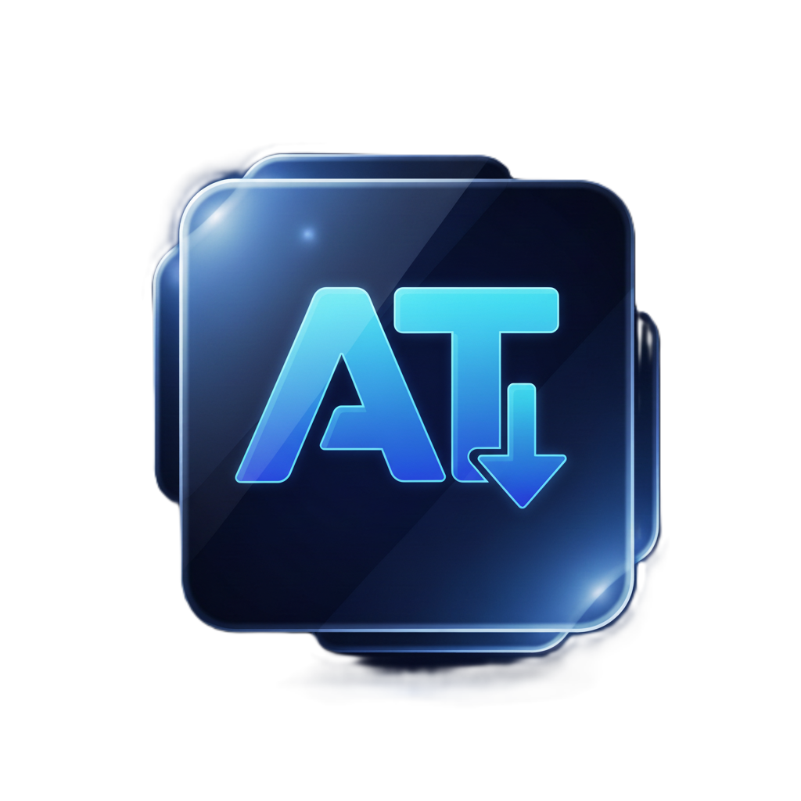

<div align="center">
  
  <h1>AT Youtube Downloader</h1>
  <p><em>Download YouTube videos and playlists as MP3 or MP4 in one click</em></p>

  
  
  
  
</div>

---

## About

**AT Youtube Downloader** is a desktop app for downloading YouTube content as **MP3 (audio)** or **MP4 (video)** through a clean, simple interface. It comes in two versions:

- **Electron app (v2.0):** the main version, with playlist support.
- **Python / PyQt6 app** (`MP3 Downloader.py`): the original, lighter version.

---

## What's new in 2.0

- 📃 **Whole playlists:** paste a playlist link and the app lists every video so you can pick the ones you want
- 📊 Playlist progress (video 3 of 12) next to the progress of the current file
- 🎚️ Quality choice: MP3 (high / medium / low) or MP4 up to the best available resolution
- ⏹️ Cancel a download at any time
- 🖥️ A completely new Electron interface

## Features

- 🎵 Download audio as **MP3**
- 🎬 Download video as **MP4** in the best available quality
- 📋 Picks up a YouTube link from the clipboard automatically
- 📂 Save files anywhere you like
- 🌙 Modern dark interface
- ⚡ Downloads run in the background without freezing the app

---

## Run the Electron app and build an EXE

```bash
npm install
npm run start        # run locally
npm run dist         # build Setup.exe into the dist folder
```

> The Electron app uses **yt-dlp**. Either install it on your PC (`pip install yt-dlp`),
> or put `yt-dlp.exe` and `ffmpeg.exe` in a folder named `bin` next to `main.js`.
> `npm run dist` then packs them into the app, so whoever installs it needs nothing else.

---

## Run the Python version

### Requirements

```
Python 3.10+
ffmpeg  (needed to convert to MP3)
```

### Install the libraries

```bash
pip install PyQt6 yt-dlp pyperclip
```

> ⚠️ Make sure **ffmpeg** is installed and added to your `PATH`.
> Download ffmpeg: https://ffmpeg.org/download.html

### Start the app

```bash
python "MP3 Downloader.py"
```

---

## Ready-made EXE

No Python needed: download a packaged build from the [Releases](https://github.com/Ahmed-Atef-Tech/Youtube_Downloader/releases) page and run it.

---

## How to use

1. Open the app
2. Paste a YouTube video or playlist link (or let the app pick it up from the clipboard)
3. For a playlist, tick the videos you want
4. Choose the format and quality: **MP3** or **MP4**
5. Choose a folder and start the download ✅

---

## Troubleshooting

| Problem | Fix |
|---|---|
| 403 Forbidden error | `pip install -U yt-dlp` (or replace `bin/yt-dlp.exe` with the latest one) |
| The file doesn't convert to MP3 | Make sure ffmpeg is installed and on your `PATH`, or in the `bin` folder |
| "yt-dlp not found" | Install it with `pip install yt-dlp`, or put `yt-dlp.exe` in the `bin` folder |

---

## Developer

**Eng. Ahmed Atef**
[](https://github.com/Ahmed-Atef-Tech)

---

## License

ISC License.
